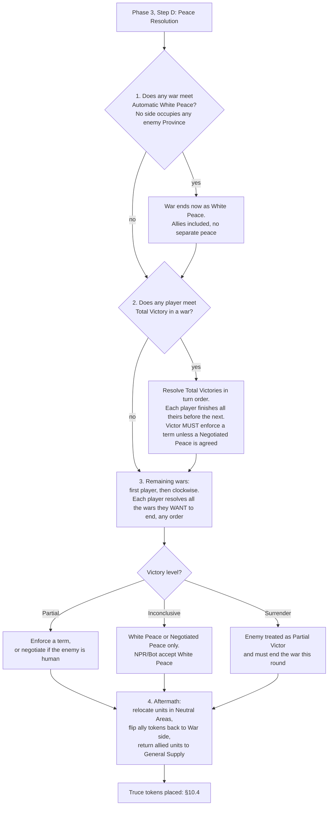

# Peace Resolution in plain English

*Based on the third printing (2026) rulebook, §10, pp. 29–31. This is a paraphrase to help you read the rules, not a replacement for them. Where we are unsure, we say so and link to [open questions](../open-questions.md).*

## The one-paragraph version

Peace is settled once per round, in **Phase 3, Step D**. First, wars where nobody has taken anything simply end. Then anyone who has crushed an enemy completely (Total Victory) cashes in, in turn order. Finally everyone else, in turn order, decides which of their remaining wars to end. How good a deal you get depends on **how well you won** (Total / Partial / Inconclusive) and **who you beat** (human, Bot or NPR). You pick **one Peace Term per enemy**, and only terms allowed by your victory level and enemy type.

## The sequence (§10.1)

Two details that are easy to miss:
- **Step 3 is optional per war.** You may leave a war running if the only terms you can enforce are bad (§10.2).
- **Vassals count as part of their Overlord's Realm** for everything here (§10, intro).

## How well did you win? (table, p. 29)

| Result | What you need | What you can do |
|---|---|---|
| **Automatic White Peace** | Neither side occupies any of the other's Provinces (including those of Vassals and Active Allies) | White Peace only. Terms are fixed. |
| **Total Victory** | You occupy **all** of one Enemy's *de jure* Provinces **and** that Enemy has no Deployed Land Units | Any term (if extra requirements met). Can make a **separate** peace with Active Allies. |
| **Partial Victory** | vs human: your Deployed Land Units **outnumber theirs 2:1**, **or** they Surrender. vs NPR/Bot: your Deployed Land Units outnumber the NPR's strength on the board plus any Deployed Enemy Land Units | Any term **except Full Annexation**. Active Allies are included in the same peace (see exception for Secure Desired Succession). |
| **Inconclusive** | None of the above | White Peace, or Negotiated Peace (human enemy). Nobody can enforce terms unless someone Surrenders. |

Notes: an NPR always counts as having 0 Deployed Land Units. Units on Distant Continents may not count (see [open question Q4](../open-questions.md)).

## Which terms can I use? (table, p. 31)

Eligibility depends on your victory level and on **who the loser is**.

| Peace Term | vs Human PR | vs Bot | vs NPR | Needs | Level |
|---|:--:|:--:|:--:|---|---|
| White Peace | ✔ | ✔ | ✔ | nothing | any (incl. Automatic) |
| Negotiated Peace | ✔ | | | both players human, agreed | any (not enforceable) |
| Keep Current Board State | ✔ | ✔ | ✔ | nothing | Partial or Total |
| Humiliation | ✔ | ✔ | | Occupy Loser's Capital (or Loser surrendered) | Partial or Total |
| Vassalization | | | ✔ | Occupy Capital + ≥1 other de jure Province elsewhere (if any) | Partial or Total |
| Force Conversion | ✔ | ✔ | ✔ | Occupy Capital; control all Provinces in Capital Area; differing religion | Partial or Total |
| Secure Desired Succession | ✔ | ✔ | ✔ | Occupy Capital; Loser's Capital has the required token (see p. 31) | Partial or Total |
| Full Annexation | | ✔ | ✔ | Occupy Capital; Loser is NPR or Bot | **Total only** |

⚠ I built this matrix from the table on p. 31 and the per-term text on pp. 30–31. If you spot a mismatch, open a [question](../open-questions.md) or a PR.

## Allies (§10.3)

- You resolve peace **on behalf of your Active Allies**; you resolve it with **one Enemy realm at a time**.
- **Automatic White Peace:** enemy Active Allies count as part of the enemy's realm. You get peace with **both**. No separate peace with an ally.
- **Total Victory:** an enemy's Active Ally is treated **separately**, like any other NPR. When you finish peace with that ally, the PR it was allied to must discard Allied Units equal to **½ of that NPR's pre-war strength**, and the war token is removed.
- **Partial Victory:** you only get a Partial Victory against the ally if you got one against its PR. Then **one** Peace Term covers every realm in that war.

## Truces (§10.4)

After peace, the parties enter a **Truce until Phase 3 of the next Round**. War tokens flip to the Truce side. **No Truce on Active Allies of former enemies, never on Vassals.** A Truce normally blocks declaring war, but a **CB token ignores the ban**.

## Cases

See the [case index](../../cases/peace-resolution/README.md).
