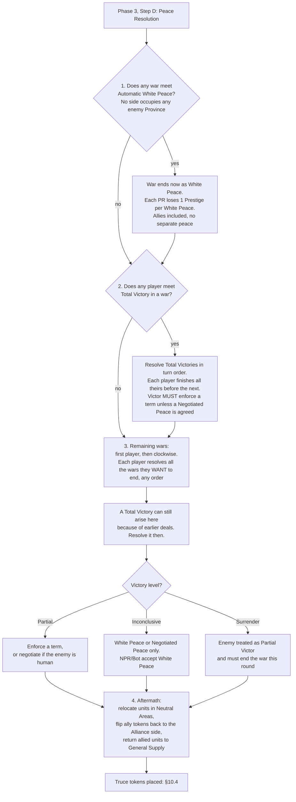

# Peace Resolution in plain English

*Based on the third printing (2026) rulebook, §10, pp. 29–31, checked against the publisher's own Peace Resolution flow chart (Player Aid B, v1.3, 2026). Use that official chart alongside this guide; we don't reproduce it here. This is a paraphrase to help you read the rules, not a replacement for them. Where we are unsure, we say so and link to [open questions](../open-questions.md).*

## The one-paragraph version

Peace is settled once per round, in **Phase 3, Step D**. First, wars where nobody has taken anything simply end. Then anyone who has crushed an enemy completely (Total Victory) cashes in, in turn order. Finally everyone else, in turn order, decides which of their remaining wars to end. How good a deal you get depends on **how well you won** (Total / Partial / Inconclusive) and **who you beat** (human, Bot or NPR). You pick **one Peace Term per enemy**, and only terms allowed by your victory level and enemy type.

## The sequence (§10.1)

Two details that are easy to miss:
- **Step 3 is optional per war, but there are no take-backs.** You may leave a war running if the only terms you can enforce are bad (§10.2). But once a player has answered "no, I don't want to end a war" they cannot answer "yes" later in the Peace Resolution step that Round (Player Aid B, footnote 3).
- **If the Victor is a Bot,** the official chart sends you to *Bot Peace Resolution* in the Solo & Bot rules (p.15) instead of the steps below.
- **Vassals count as part of their Overlord's Realm** for everything here (§10, intro; for NPRs also §13.2, p.35). See [PR-015](../../cases/peace-resolution/015-npr-with-vassals.md).
- **You Enforce on your own turn only.** The steps run in Turn Order, and the designer confirmed you can only Enforce Peace Terms on *your* turn (🟢 Eivind, Sep 2026). You may still negotiate on your turn. See [PR-019](../../cases/peace-resolution/019-enforce-on-your-own-turn.md).
- **A Total Victory can arise in step 3.** One player's deal can change another war, so a Total Victory that did not exist in step 2 can appear later and is resolved then (🟢 Mikhs, May 2026). Step 2 is mandatory (the Victor *must* enforce a term unless a Negotiated Peace is agreed). In step 3 enforcing is optional. See [PR-010](../../cases/peace-resolution/010-total-victory-created-by-another-peace.md), [PR-011](../../cases/peace-resolution/011-total-victory-removes-ally-then-white-peace.md), [PR-012](../../cases/peace-resolution/012-total-victory-after-partial-victory-resolves.md).
- **Allies resolve separately, unless the ally is an NPR Active Ally.** Two PRs at war with the same enemy each get their own Peace Resolution, in Turn Order, and their occupied Provinces do **not** combine for Total Victory (🟢 Eivind, Sep 2026). See [PR-013](../../cases/peace-resolution/013-two-prs-one-npr.md), [PR-016](../../cases/peace-resolution/016-two-allied-prs-one-human-enemy.md).
- **Only PRs can be Victors.** NPRs never Occupy Provinces, so a successful NPR Invasion leaves Rebels. See [PR-014](../../cases/peace-resolution/014-npr-counter-invasion-rebels.md).
- **Automatic White Peace is not the White Peace term.** It ends the war on the current board and does **not** restore pre-war conditions, and Prestige is still lost (Player Aid B; 🟢 Mikhs, Sep 2026).
- **"Controlled" means Owned or Occupied.** Force Conversion needs you to Control the whole Capital Area, and your own Vassals' Provinces don't count (🟢 Mikhs, Oct 2026). See [PR-020](../../cases/peace-resolution/020-force-conversion-control.md).
- **Active Ally Provinces under Keep Current Board State** are handled in [PR-021](../../cases/peace-resolution/021-active-ally-provinces-keep-current-board-state.md). One Peace Term covers the PR and its Active Allies, applied separately to each.
- **Ducats in one peace are settled together** (🟡 Miroku20X6, Oct 2026): see [PR-017](../../cases/peace-resolution/017-negotiated-peace-ducats-settled-together.md).

## How well did you win? (table, p. 29)

| Result | What you need | What you can do |
|---|---|---|
| **Automatic White Peace** | Neither side occupies any of the other's Provinces (including those of Vassals and Active Allies) | White Peace only. Terms are fixed. **Each PR loses 1 Prestige per White Peace it enters** (Player Aid B). |
| **Total Victory** | You occupy **all** of one Enemy's *de jure* Provinces **and** that Enemy has no Deployed Land Units | Any term (if extra requirements met). Can make a **separate** peace with Active Allies. |
| **Partial Victory** | vs human: **either player** with **twice as many** Deployed Land Units as the other (exactly 2× is enough; you still enforce on your own turn), **or** the enemy Surrenders. vs NPR/Bot: your Deployed Land Units outnumber the Rebel Units in your Areas plus any Deployed Enemy Land Units (NPRs have none), see [PR-022](../../cases/peace-resolution/022-partial-victory-vs-npr-rebel-units.md) | Any term **except Full Annexation**. Active Allies are included in the same peace (see exception for Secure Desired Succession). |
| **Inconclusive** | None of the above | White Peace, or Negotiated Peace (human enemy). Nobody can enforce terms unless someone Surrenders. |

Notes: an NPR always counts as having 0 Deployed Land Units. Land Units on Distant Continents **where the enemy PR has no Town do not count** towards these comparisons (Player Aid B, footnote 5). Only **human** players can Surrender, and a player who Surrenders is the Loser (Player Aid B, footnote 6).

## Which terms can I use? (table, p. 31)

Eligibility depends on your victory level and on **who the loser is**.

| Peace Term | vs Human PR | vs Bot | vs NPR | Needs | Level |
|---|:--:|:--:|:--:|---|---|
| White Peace | ✔ | ✔ | ✔ | nothing | any (incl. Automatic) |
| Negotiated Peace | ✔ | | | both players human, agreed | any (not enforceable) |
| Keep Current Board State | ✔ | ✔ | ✔ | nothing | Partial or Total |
| Humiliation | ✔ | ✔ | | Occupy Loser's Capital (or Loser surrendered) | Partial or Total |
| Vassalization | | | ✔ | Occupy Capital + ≥1 other de jure Province elsewhere (if any) | Partial or Total |
| Force Conversion | ✔ | ✔ | ✔ | Occupy Capital; control all Provinces in Capital Area; differing religion | Partial or Total |
| Secure Desired Succession | ✔ | ✔ | ✔ | Occupy Capital; Loser's Capital has the required token (see p. 31) | Partial or Total |
| Full Annexation | | ✔ | ✔ | Occupy Capital; Loser is NPR or Bot | **Total only** |

⚠ I built this matrix from the table on p. 31 and the per-term text on pp. 30–31. If you spot a mismatch, open a [question](../open-questions.md) or a PR.

## Allies (§10.3)

- You resolve peace **on behalf of your Active Allies**; you resolve it with **one Enemy realm at a time**.
- **Automatic White Peace:** enemy Active Allies count as part of the enemy's realm. You get peace with **both**. No separate peace with an ally.
- **Total Victory:** an enemy's Active Ally is treated **separately**, like any other NPR. When you finish peace with that ally, the PR it was allied to must discard Allied Units equal to **½ of that NPR's pre-war strength**, and the war token is removed.
- **Partial Victory:** you only get a Partial Victory against the ally if you got one against its PR. Then **one** Peace Term covers every realm in that war.

## Truces (§10.4)

After peace, the parties enter a **Truce until Phase 3 of the next Round**. War tokens flip to the Truce side. **No Truce on Active Allies of former enemies, never on Vassals.** A Truce normally blocks declaring war, but a **CB token ignores the ban**.

## Defending the HRE (§18.4, p.44) 🔵

While the Emperor has the **Defending the HRE** slot tagged, an **external Aggressor** may **never** resolve peace separately with an NPR Imperial Subject, **unless** they have a Total or Partial Victory over the Emperor. Otherwise they must resolve peace with the **Emperor**, and any NPR Imperial Subjects at war with the Emperor's enemies are treated as the Emperor's **Active Allies**. This is why War token placement matters for the HRE: see [Wars and Truces](../general/wars-and-truces.md).

## Table houserules (🟣 not official)

Some tables play slightly differently. These are **not** the rules, and each is labelled in its case:
- Allow a **joint annexation** when allied PRs between them hold every Province ([PR-013](../../cases/peace-resolution/013-two-prs-one-npr.md)).
- Allow negotiation to happen **twice**, so players can react to resolutions between their turns ([PR-019](../../cases/peace-resolution/019-enforce-on-your-own-turn.md)).

## Cases

See the [case index](../../cases/peace-resolution/README.md).
